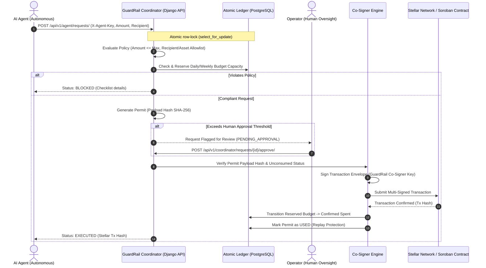

# GuardRail: Policy-Controlled Capital Governance for AI Agents

[](https://www.djangoproject.com/)
[](https://www.django-rest-framework.org/)
[](http://localhost:8000/api/docs/)
[](https://stellar.org/)
[](https://soroban.stellar.org/)
[](https://www.docker.com/)

**GuardRail** is a policy-controlled capital management infrastructure built on Stellar that enables autonomous AI agents to initiate financial transactions without giving them unrestricted control over digital assets.

By decoupling transaction initiation from final authorization, GuardRail introduces an enforceable programmable security boundary between AI agents and protected treasury wallets.

---

## 1. System Architecture & Core Flow



### The Security Boundary Model
- **Independent Transfer Prevention**: The controlled wallet is configured on Stellar with signing weights:
  - Agent signer: **Weight 1**
  - GuardRail co-signer: **Weight 1**
  - Medium threshold (payments): **Weight 2**
  - Result: An agent alone **cannot** sign or move funds. Final payment execution strictly requires the co-signer signature, which is only released when off-chain or on-chain policy checks pass.
- **Single-Use Cryptographic Permits**: Every permit is bound to a SHA-256 digest of the canonical transaction parameters (`recipient`, `amount`, `asset`, `wallet`, `policy_id`, `request_id`). Any modification causes hash mismatch and immediate rejection.
- **Race Condition Immunity**: Parallel requests lock the wallet's `SpendingLedger` using `select_for_update()` inside atomic database transactions, preventing double-spend and budget overdraft attacks.

---

## 2. Soroban Smart Contract Architecture (`contracts/guardrail/`)

GuardRail includes an on-chain **Soroban Smart Contract** written in Rust (`no_std`), offering enterprise-grade capital governance directly on the Stellar Virtual Machine (SVM). The contract enforces policy boundaries natively on the blockchain, guaranteeing that treasury funds cannot be diverted even in the event of compromised agent infrastructure.

```
+-----------------------------------------------------------------------------------+
|                        SOROBAN SMART CONTRACT BOUNDARY                            |
|                                                                                   |
|  +---------------------+   +-----------------------+   +-----------------------+  |
|  |     AI Agent        |   |   GuardRail CoSigner  |   |    Operator Admin     |  |
|  |  (Initiator Auth)   |   | (Dual-Sign Approval)  |   | (Policy & Circuit Br) |  |
|  +----------+----------+   +-----------+-----------+   +-----------+-----------+  |
|             |                          |                           |              |
|             +------------+-------------+                           |              |
|                          |                                         |              |
|                          v                                         v              |
|         +----------------------------------+     +-------------------------------+|
|         |    execute_permitted_payment     |     |   Admin & Policy Controls     ||
|         |----------------------------------|     |-------------------------------||
|         | 1. Dual Auth (Agent + CoSigner)  |     | * initialize                  ||
|         | 2. Replay Guard (BytesN<32>)     |     | * update_policy               ||
|         | 3. Temporal Expiry Validation    |     | * set_recipient_status        ||
|         | 4. Recipient & Token Allowlist   |     | * set_token_status            ||
|         | 5. Per-Tx Stroop Ceiling Check   |     | * set_agent_active            ||
|         | 6. Rolling 24h & 7d Window Math  |     | * pause / unpause             ||
|         | 7. SEP-41 Token Transfer         |     | * get_spending_status         ||
|         +----------------+-----------------+     +---------------+---------------+|
|                          |                                       |                |
+--------------------------|---------------------------------------|----------------+
                           v                                       v
               +-----------------------+               +-----------------------+
               |  SEP-41 Token Client  |               | Stellar Ledger State  |
               | (Transfers to Allowlist)              | (Persistent & Instance)
               +-----------------------+               +-----------------------+
```

### 2.1 State Storage & Key Hierarchy

The contract segments memory into **Instance Storage** (core contract configuration and rolling budget tracking) and **Persistent Storage** (scalable allowlists and replay-prevention permits):

| Storage Key | Storage Tier | Type | Purpose |
| :--- | :--- | :--- | :--- |
| `DataKey::Admin` | Instance | `Address` | Operator administrator controlling policies and allowlists. |
| `DataKey::CoSigner` | Instance | `Address` | GuardRail coordinator co-signer public address. |
| `DataKey::Agent` | Instance | `Address` | Autonomous AI agent account address. |
| `DataKey::AgentActive` | Instance | `bool` | Flag designating whether the agent can execute payments. |
| `DataKey::Policy` | Instance | `PolicyConfig` | Active financial limits and approval thresholds. |
| `DataKey::IsPaused` | Instance | `bool` | Emergency circuit breaker halt switch. |
| `DataKey::DailySpending` | Instance | `i128` | Cumulative volume (in stroops) spent in active 24h window. |
| `DataKey::WeeklySpending` | Instance | `i128` | Cumulative volume (in stroops) spent in active 7d window. |
| `DataKey::LastDailyReset` | Instance | `u64` | UNIX timestamp marking start of active daily window. |
| `DataKey::LastWeeklyReset` | Instance | `u64` | UNIX timestamp marking start of active weekly window. |
| `DataKey::AllowedRecipient(Address)` | Persistent | `bool` | Allowlist mapping approved destination addresses. |
| `DataKey::AllowedToken(Address)` | Persistent | `bool` | Allowlist mapping approved SEP-41 token contracts. |
| `DataKey::ExecutedPermit(BytesN<32>)`| Persistent | `bool` | Replay protection record tracking consumed permit digests. |

---

### 2.2 Smart Contract Entrypoints

#### `initialize(e: Env, admin: Address, cosigner: Address, agent: Address, policy: PolicyConfig)`
Initializes the contract with governance roles and default financial policies.
- **Access Control**: Requires `admin.require_auth()`. One-time invocation guard (`GuardrailError::AlreadyInitialized`).
- **Events Emitted**: `(symbol_short!("init"), admin)`.

#### `update_policy(e: Env, policy: PolicyConfig)`
Updates financial limits, daily/weekly ceilings, and human approval threshold.
- **Access Control**: Requires `admin.require_auth()`.
- **Validation**: Enforces `0 < max_per_tx <= daily_limit <= weekly_limit`.

#### `set_recipient_status(e: Env, recipient: Address, allowed: bool)`
Adds or removes a destination account from the approved recipient allowlist.
- **Access Control**: Requires `admin.require_auth()`.
- **Events Emitted**: `(symbol_short!("rec_upd"), recipient, allowed)`.

#### `set_token_status(e: Env, token: Address, allowed: bool)`
Permits or disables a SEP-41 token contract (e.g., Native XLM wrapper, Circle USDC).
- **Access Control**: Requires `admin.require_auth()`.
- **Events Emitted**: `(symbol_short!("tok_upd"), token, allowed)`.

#### `set_agent_active(e: Env, active: bool)`
Enables or disables payment execution rights for the AI agent.
- **Access Control**: Requires `admin.require_auth()`.

#### `pause(e: Env)` & `unpause(e: Env)`
Instantaneous circuit breaker. Halts or restores all capital movement.
- **Access Control**: Requires `admin.require_auth()`.

#### `execute_permitted_payment(e: Env, permit_id: BytesN<32>, recipient: Address, token: Address, amount: i128, expires_at: u64)`
Primary capital execution gate. Transfers tokens from contract custody to `recipient`.
- **Dual Authentication**: Requires both `agent.require_auth()` AND `cosigner.require_auth()`.
- **Replay Protection**: Verifies `!has(DataKey::ExecutedPermit(permit_id))` and records consumption.
- **Temporal Validity**: Validates `current_timestamp <= expires_at`.
- **Allowlist Verification**: Asserts `recipient` is allowed and `token` is approved.
- **Policy Enforcement**: Asserts `amount <= max_amount_per_tx`, updates rolling daily/weekly windows, and verifies `daily_spent <= daily_limit` and `weekly_spent <= weekly_limit`.
- **Execution**: Invokes `soroban_sdk::token::Client::new(&e, &token).transfer(&contract_address, &recipient, &amount)`.
- **Events Emitted**: `(symbol_short!("payment"), permit_id, recipient, amount)`.

#### `get_spending_status(e: Env) -> SpendingStatus`
Read-only inspection endpoint returning real-time rolling daily spent, weekly spent, remaining daily budget, and remaining weekly budget in stroops.

---

### 2.3 Error Code Specification

| Code | Variant | Root Cause |
| :---: | :--- | :--- |
| `1` | `AlreadyInitialized` | Attempted re-initialization of already active contract. |
| `2` | `NotInitialized` | Invocation attempted prior to `initialize()`. |
| `3` | `ContractPaused` | Circuit breaker active (`pause()` was triggered). |
| `4` | `AgentInactive` | Agent credentials disabled via `set_agent_active(false)`. |
| `5` | `PermitAlreadyUsed` | Replay attempt: `permit_id` was already executed. |
| `6` | `PermitExpired` | Current ledger timestamp exceeds `expires_at`. |
| `7` | `RecipientNotAllowed`| Destination address is not present in allowlist. |
| `8` | `TokenNotAllowed` | Asset token contract is not present in allowlist. |
| `9` | `AmountExceedsMaxPerTx` | Payment exceeds single-transaction ceiling. |
| `10`| `DailyLimitExceeded` | Payment would exceed rolling 24-hour limit. |
| `11`| `WeeklyLimitExceeded` | Payment would exceed rolling 7-day limit. |
| `12`| `InvalidAmount` | Amount is zero or negative. |
| `13`| `Unauthorized` | Caller failed required cryptographic signature verification. |

---

### 2.4 Compilation, Testing & Deployment

#### 1. Run Contract Unit Tests
Execute the comprehensive Soroban Rust test suite:
```bash
cargo test --manifest-path contracts/guardrail/Cargo.toml
```
All 11 unit tests validate nominal execution, single-use replay protection, expiry rejection, allowlist enforcement, rolling budget resets, and emergency pause semantics:
- `test::test_initialization_and_policy`
- `test::test_successful_payment_execution`
- `test::test_replay_protection_permit_already_used`
- `test::test_expired_permit_rejected`
- `test::test_unauthorized_recipient_blocked`
- `test::test_unauthorized_token_blocked`
- `test::test_exceeding_max_per_tx_blocked`
- `test::test_daily_spending_budget_enforced`
- `test::test_emergency_pause_blocks_execution`
- `test::test_unpause_restores_execution`
- `test::test_deactivated_agent_blocked`

#### 2. Compile Contract to WebAssembly (WASM)
```bash
cargo build --target wasm32-unknown-unknown --release --manifest-path contracts/guardrail/Cargo.toml
```

#### 3. Optimize Contract Binary
```bash
soroban contract optimize --wasm target/wasm32-unknown-unknown/release/guardrail.wasm
```

#### 4. Deploy to Stellar Testnet
```bash
soroban contract deploy \
  --wasm target/wasm32-unknown-unknown/release/guardrail.optimized.wasm \
  --source-account <OPERATOR_SECRET_KEY> \
  --network testnet
```


---

## 3. Backend Architecture (Django & DRF)

Built with a modular Django architecture adhering to clean enterprise design:

| Module | Responsibility |
| :--- | :--- |
| `apps.core` | Abstract UUID models, SHA-256 canonical payload hashing, 7-decimal stroop math, Stellar SDK wrappers. |
| `apps.accounts` | Operator identity, SEP-10 challenge-response authentication with Ed25519 signature verification. |
| `apps.wallets` | Controlled wallet registry, multisig weight configuration, security boundary compliance audits. |
| `apps.policies` | Financial policy engine, per-tx limits, daily/weekly budgets, recipient/asset allowlists. |
| `apps.agents` | AI Agent registration, hashed API keys (`gr_live_...`), credential rotation, emergency killswitch. |
| `apps.coordinator` | Core request evaluation, permit generation, budget reservation, operator approval & co-signing. |
| `apps.audit` | Immutable audit log mapping decisions, permit hashes, and Stellar Explorer URLs. |
| `apps.smart_contracts` | Soroban contract simulation, status inspection, and on-chain event verification. |

---

## 4. Swagger & OpenAPI 3.0 Documentation

Interactive API documentation is automatically generated via `drf-spectacular`:

- **Swagger UI**: [http://localhost:8000/api/docs/](http://localhost:8000/api/docs/)
- **ReDoc**: [http://localhost:8000/api/redoc/](http://localhost:8000/api/redoc/)
- **OpenAPI 3.0 Schema**: [http://localhost:8000/api/schema/](http://localhost:8000/api/schema/)

### Authentication Schemes in Swagger
- **AgentApiKeyAuth**: Header `X-Agent-Key: gr_live_<secret>` for autonomous agents.
- **Operator Session / Signature**: Challenge-response endpoints for operators.

---

## 5. API Endpoints Reference

### AI Agent Endpoints (Authenticated via `X-Agent-Key`)
```http
POST   /api/v1/agent/requests/            # Propose a transaction (evaluates policy & issues permit)
GET    /api/v1/agent/requests/{req_id}/   # Check request status, permit, and Stellar tx hash
GET    /api/v1/agent/policy-summary/      # Active limits, remaining budgets, and allowlists
```

#### Example Agent Request:
```json
POST /api/v1/agent/requests/
Headers:
  X-Agent-Key: gr_live_9a7b...
Body:
{
  "request_id": "agent_req_20261026_001",
  "recipient": "GB54HQQPWRACHYXERO2JN7RBTMNREQMQ7B3XLRCVWPKZS3NXO7PN2BTE",
  "amount": "12.5000000",
  "asset": "XLM"
}
```

### Operator & Coordinator Endpoints
```http
# Operator Authentication (SEP-10 style)
POST   /api/v1/auth/challenge/            # Request cryptographic challenge nonce
POST   /api/v1/auth/verify/               # Verify Ed25519 signature & login (persists alias)
GET    /api/v1/auth/me/                   # Current operator profile
PATCH  /api/v1/auth/me/                   # Update operator profile (alias / username)

# Controlled Wallets & Security Boundary
GET    /api/v1/wallets/                   # List controlled wallets
POST   /api/v1/wallets/                   # Register controlled wallet
GET    /api/v1/wallets/{id}/security-audit/ # Audit multisig weights & thresholds

# Policies & Budget Management
GET    /api/v1/policies/                  # List active policies
POST   /api/v1/policies/{id}/budget-status/ # Real-time daily/weekly spending remaining
POST   /api/v1/policies/{id}/add-recipient/ # Add address to allowlist
POST   /api/v1/policies/{id}/add-asset/     # Add asset to allowlist

# AI Agent Supervision
GET    /api/v1/agents/                    # List registered AI agents
POST   /api/v1/agents/                    # Register agent (returns secret API key once)
POST   /api/v1/agents/{id}/rotate-key/    # Invalidate old credentials & issue new
POST   /api/v1/agents/{id}/emergency-disable/ # Instant killswitch to halt co-signing
POST   /api/v1/agents/{id}/activate/      # Re-enable disabled agent

# Coordinator Requests & Approvals
GET    /api/v1/coordinator/requests/      # Filter requests (PENDING_APPROVAL, BLOCKED, etc.)
GET    /api/v1/coordinator/requests/{id}/ # Detailed request view with policy checklist
POST   /api/v1/coordinator/requests/{id}/approve/ # Operator human approval
POST   /api/v1/coordinator/requests/{id}/reject/  # Operator rejection (releases reserved budget)
POST   /api/v1/coordinator/requests/{id}/cosign-and-submit/ # Co-sign & submit to Stellar Testnet
GET    /api/v1/coordinator/permits/       # Inspect single-use authorization permits
GET    /api/v1/coordinator/dashboard-stats/ # Aggregated metrics for dashboard cards

# Audit Log
GET    /api/v1/audit/logs/                # Immutable history with Stellar Explorer links

# Soroban Smart Contract
GET    /api/v1/smart-contract/status/     # Inspect contract parameters
POST   /api/v1/smart-contract/simulate/   # Simulate on-chain permit execution
```

---

## 6. Local Quickstart

### Prerequisites
- Python 3.13+
- Rust & Cargo 1.80+ (optional, for Soroban contract compilation)
- Docker & Docker Compose (optional, for containerized run)

### 1. Setup Virtual Environment
```bash
python3 -m venv venv
source venv/bin/activate
pip install -r requirements.txt
```

### 2. Configure Environment
```bash
cp .env.example .env
```

### 3. Run Migrations & Start Server
```bash
python manage.py migrate
python manage.py runserver 0.0.0.0:8000
```
Visit [http://localhost:8000/api/docs/](http://localhost:8000/api/docs/) to view the Swagger interface.

---

## 7. Frontend Application & Screen Flows (`frontend/`)

GuardRail features an enterprise-grade React dashboard built with Tailwind CSS, Lucide icons, and the official Stellar Wallets Kit.

### Screen Flows & Features
- **Landing Page (`/`)**: Architecture walkthrough, core value proposition, feature overview, and direct call-to-actions to launch the app or start onboarding.
- **Onboarding & Sign-Up Flow (`/onboarding`)**:
  1. **Connect Official Stellar Wallet**: Integrates `@creit.tech/stellar-wallets-kit` supporting Freighter, xBull, and Albedo on Stellar Testnet.
  2. **Cryptographic SEP-10 Verification**: Requests a nonce challenge from `/api/v1/accounts/challenge/` and verifies the operator's Ed25519 signature.
  3. **Soroban Smart Contract Binding**: Connects treasury wallet to `/api/v1/smart-contracts/status/` and registers the controlled treasury in the coordinator registry (`/api/v1/coordinator/wallets/`).
- **Dashboard Navigation Profile**:
  - Live operator wallet profile badge in both the sticky Top Header and collapsible Sidebar.
  - Real-time Stellar Testnet XLM balance fetched directly from Horizon Testnet (`/accounts/{address}`).
  - Dynamic status indicator with pulse animation and modal management.
- **Transaction Flow & Modal Review**:
  - Real-time policy checklists (Rule 1 through Rule 6).
  - Quick Approve / Reject and comprehensive Co-signing modal calling `/api/v1/coordinator/requests/{id}/approve/` and `/cosign/`.
- **Policy Configuration (`/policies`)**: Live limits management updating `/api/v1/coordinator/policies/{id}/`.
- **Zero Placeholder / Mock Data**: All views query and mutate live backend DRF endpoints with full TypeScript definitions.

---

## 8. Docker Deployment

The entire stack is containerized with multi-stage, security-hardened Dockerfiles:
- **`db`**: PostgreSQL 16 Alpine with persistent data volume and healthchecks.
- **`web`**: Python 3.13 Slim running Django + Gunicorn on port `8000`.
- **`frontend`**: Node 22 Alpine builder + Nginx Alpine running on port `3000` with automated SPA routing and `/api/` proxying to `web`.

### Build & Run Stack with Docker Compose
```bash
# Build all images (db, web, frontend)
docker compose build

# Start services in the background
docker compose up -d
```

### Accessing the Platform
- **Frontend Dashboard**: [http://localhost:3000](http://localhost:3000)
- **Coordinator API**: [http://localhost:8000](http://localhost:8000)
- **Interactive Swagger Docs**: [http://localhost:8000/api/docs/](http://localhost:8000/api/docs/)
- **Health Check**: [http://localhost:8000/health/](http://localhost:8000/health/)

---

## 9. Comprehensive Test Suite

Both backend unit tests and smart contract unit tests are automated:

### Run Django Unit Tests (38 Tests)
```bash
pytest
```
```text
============================== 38 passed in 0.45s ==============================
```

### Run Soroban Contract Tests (11 Tests)
```bash
cargo test --manifest-path contracts/guardrail/Cargo.toml
```
```text
test result: ok. 11 passed; 0 failed; 0 ignored; finished in 0.03s
```

### Test Coverage Highlights
- [x] **Rule 1 (Max Single Amount)**: Amounts exceeding limit blocked.
- [x] **Rule 2 (Daily Spending Budget)**: Cumulative daily spend capped at budget limit.
- [x] **Rule 3 (Recipient Allowlist)**: Transfers to unapproved Stellar addresses blocked.
- [x] **Rule 4 (Asset Allowlist)**: Transfers involving non-whitelisted tokens blocked.
- [x] **Rule 5 (Human Oversight)**: Requests exceeding approval threshold gated for operator review.
- [x] **Replay Protection**: Single-use permits cannot be executed a second time.
- [x] **Tampering Detection**: Any modification to amount/recipient after permit issuance triggers hash mismatch error.
- [x] **Rejection Accounting**: Operator rejection immediately releases reserved budget back to available balance.
- [x] **Idempotency**: Repeated requests with the same `request_id` do not reserve double budget or trigger duplicate payments.
- [x] **Multisig Boundary**: Proof that Agent signing weight alone is insufficient to satisfy transaction thresholds.
- [x] **Killswitch Verification**: Emergency-disabled agent is immediately rejected by authentication and policy layers.

---

## 10. Security & Compliance Summary

1. **Private Key Segregation**: The GuardRail co-signer secret key is isolated in environment variables/KMS. It is never exposed in API responses or visible to AI agents.
2. **Deterministic Stroop Precision**: All financial operations use Python `Decimal` and Rust `i128` stroops to eliminate IEEE 754 floating-point rounding vulnerabilities.
3. **Defense-in-Depth**: Policy checks are evaluated off-chain before co-signing, and re-verified on-chain via Soroban smart contracts.
